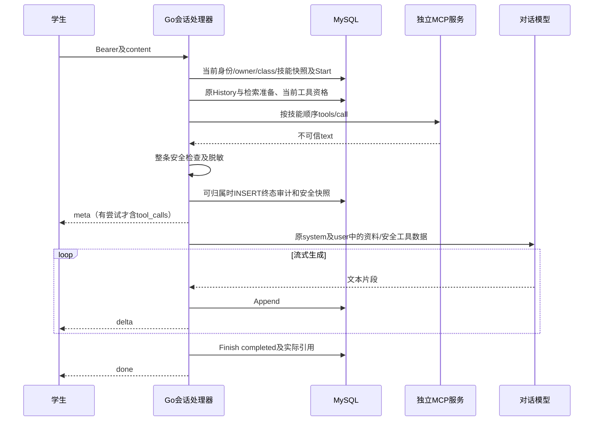

> **Phase 6 最终状态（2026-10-19）：42/42，按用户批准的项目调整标准完成。** 6.5/T71采用受控HTTP模型、真实MCP和自动技术复核；6.7/T68采用独立账号模拟交叉验证4/4。未调用真实付费模型、未执行用户人工审阅、未邀请真实同伴，不代表课程原始参与要求已完成。72项技术断言、strict及保护检查通过；下方旧状态及原始要求保留历史时点。详见[最终报告](phase6-verification.md)、[逐项覆盖](phase6-coverage.md)和[用户调整](phase6-user-decisions.md)。已停止，不提交、推送或归档。

> **当前 Phase 4 状态（2026-10-19）：4.1–4.7 已验收，累计30/42；Phase 5–6的12项未实施。** 技能引用、确定性MCP执行、安全输出、meta及历史快照、终态审计和第五课回归见[Phase 4报告](phase4-verification.md)与phase4-verification.json。下方旧阶段措辞保留历史时点；本轮未修改页面、默认Compose或调用真实模型。

> **当前 Phase 3 状态（2026-10-18）：3.1–3.6 已验收，累计 23/42；Phase 4–6 的 19 项未实施。** 八个教师管理操作、真实 MCP 发现、隔离 MySQL/HTTP 和旧技能/RAG/SSE 回归证据见 [Phase 3 报告](phase3-verification.md)与 phase3-verification.json。下方旧阶段措辞保留原时点；本次未接技能工具编排、SSE 或前端。

> **Phase 2实施注记（2026-10-18）：** 已按冻结合同实现三张MCP表及基础组件，v4四步为原账本追加可空ddl_hash和三张MCP表，旧41条DDL/hash保持；另写v4 receipt保留原receipt。当前累计17/42；下方设计/Phase0冻结记录中的“尚未实施/不执行DDL”为原规划时点，最新证据见[Phase 2报告](phase2-verification.md)。公共合同及72项规格不改，管理路由/技能/SSE仍待后续授权。

## Context

**官方来源已读取，规约待审核，尚未实施。** 本轮直接只读HTTP访问取得任务清单、课件概览和导航全部9个子页面，读取所有正文、代码示例、表格及流程图文字，并解析官方 /week06/openapi.json 的全部8个MCP操作及相关schema。早前web工具失败是真实历史，本轮不继续把已核实内容标pending-source-verification。来源清单、节号、冲突与72项双向映射见requirements-traceability；读取摘要见verification-result.json。Swagger仅取页面HTML，未登录或Execute，原型只检查入口，不能据此声称浏览器/业务验收通过。

当前仓库基线仍为Go net/http、MySQL v3严格catalog、现有技能source与词法路由、会话消息SSE；旧/api/ask为非流式。第五课文件、数据库、Demo及模型账本本轮不变。现有change与编号保留，不新建change或main spec。

## Goals / Non-Goals

目标：以课程8个接口、字段和可观察行为为兼容基线，真正通过独立服务完成发现—绑定—确定性调用—安全处理—SSE—审计，保护第五课实现。项目补强须与课程示范分开说明，不能改变兼容输出。

非目标：通用Agent/模型自主选工具、写操作工具、标准MCP全栈认证/传输、自动重试/重放、第二套OpenAPI、公开会话删除、正式部署或资源清理。课程HTTP JSON-RPC子集不等于完整标准MCP；真实跨进程网络调用仍是必需。

## Decisions

## Phase 0 冻结记录（2026-10-18，Asia/Shanghai）

本次用户明确指定现有 change，仅授权 0.1–0.4；该指令构成本次 Q1–Q5 与 D1–D8 所列取舍的审核依据。下方历史“待审核”描述保留其原时点，当前以本节、phase0-baseline.md 最新记录和 verification-result.json.phase0_review 为准。72 项合同和主场景原文不改；Phase 1–6 仍未实施。

- D1/D2：独立 HTTP JSON-RPC、POST /mcp、Bearer、initialize/tools/list/tools/call；主工具 formula_hint、unit_convert。不要求完整 Streamable HTTP、SDK、session 或 GET SSE。
- D3/D4：保留官方八操作及字段/错误边界，无公开详情/discover；tool@server、引用各32字、六分隔符、保存前四校验、当前班级名称解析，无第四张稳定ID绑定表。存储64与引用32分别约束。
- D4/D5：仅追加终态审计；有审计删除503、无审计物理删除204；断开denied有审计，改名/成功删除导致旧名失配denied无不可归属审计。名称复用和调用后审计前崩溃风险明确接受为已披露限制，未声称解决。
- D6/D7：调用先于meta；尝试项ref/status/text，无尝试省略tool_calls；危险句式或超过1200 Unicode字的完整合并正文整条丢弃。安全结果仅进入user外部数据位，不提升system、不伪造知识库引用。
- A：服务Token采用服务端AES-GCM；主密钥由环境或Secret注入，凭据逻辑输入auth_token、输出has_auth。使用独立随机nonce，认证失败拒绝使用；key_id用于识别密钥。主密钥、明文Token不入响应/日志/Git/镜像，不透传学生JWT；部署密钥缺失时关闭相关能力或启动失败，不能退化为明文存储。
- B/C：每技能最多3个不同MCP引用、单次3秒、阶段10秒、整轮120秒，tools/call不自动重试。formula_hint.query为当前问题原文；unit_convert仅确定性解析value/from/to，歧义或无法明确解析denied且零RPC。上述数值和解析范围均是项目工程选择。
- D：出站URL/scheme/Host/Port/IP/CIDR校验、DNS重绑定防护、固定已验证IP拨号、禁重定向及云metadata；明确Compose服务名mcp-demo:8090与本次专用网络CIDR成对允许，不能笼统放行全部私网。连接前/解析后均校验，IPv4/IPv6及所有解析地址需受控；不能由任意用户配置绕过metadata禁令。正常Compose可达性与攻击目标零访问均由T27后续实测。
- E/F：保留现有JWT/ver撤销/Principal/班级隔离。认证存储500是既有兼容差异，MCP业务DB故障503，分别测试和披露；本轮不重构认证。MCP审计外键及历史保留，未规定天数，不新增清理。
- 来源解释：接受详细字段页的加密存储解释、403/404分工、字段并集、存储64/引用32、空Token保留；连接失败“不发布新缓存”同时置false并清失效缓存。它们仍是对已登记来源差异的项目处理，不能写成官方从无矛盾。

与当前源码兼容是指存在可扩展接缝，并不表示这些能力已经实现。v4就绪检查必须明确识别保留的v3完成记录与新增v4记录，不能继续套用当前“账本总行数=1”断言；旧v3二进制不兼容v4。具体升级实现和真实验证属于2.1–2.3，见phase0-baseline.md计划。

Phase 0 技术与规划门槛通过后仍须停止；任何Phase 1实施、正式库预检/迁移、容器或付费模型操作均不由本节授权。


### D1 协议及独立服务

官方强制：同仓mcp-server/，Compose与API同网，POST /mcp、/health、Bearer环境令牌、initialize、tools/list、tools/call、至少两个真实可发现/可调用工具。主机配置base_url（≤512字），trim尾斜线再补/mcp；不能要求教师填完整RPC端点或只mock主机结果。

课程明确采用HTTP上的JSON-RPC复刻工具结构，**没有要求完整Streamable HTTP、GET SSE、session、批量、SDK或notifications/initialized**。移除上一版把这些当验收前提的要求。项目用独立Go module/二进制和普通HTTP JSON实现，容器监听8090、服务名mcp-demo、环境MCP_AUTH_TOKEN均为采用课程示范的工程选择（官方示例允许变化）。initialize候选发送protocolVersion=2025-03-26及clientInfo，服务回serverInfo/capabilities.tools；该版本字符串是项目协商选择，不代表已实现该版本完整传输。与标准MCP服务器互操作留可选后续，不能隐性引入SDK冻结门槛。

JSON-RPC：UTF8，jsonrpc=2.0，id匹配；请求包含method/params，响应result或error互斥。未知方法、畸形JSON、非法参数提供可读error；项目采用-32700/-32600/-32601/-32602/-32603。HTTP缺/错Bearer401，GET /health为最小存活信息，不返回密钥。独立服务的401在教师connect层转换502，不能误作学生JWT过期。

```json
{"jsonrpc":"2.0","id":1,"method":"tools/call","params":{"name":"formula_hint","arguments":{"query":"去括号这一步我不会"}}}
{"jsonrpc":"2.0","id":1,"result":{"content":[{"type":"text","text":"先检查括号前系数是否乘到每一项，并检查符号。"}],"isError":false}}
```

tools/list返回name/description/inputSchema，tools/call返回文本content数组及isError。远端text允许普通中文，不要求text内再套项目JSON。只处理支持的text，拒绝非法content/id/编码，不把描述或Schema当模型指令。工具错误与RPC错误都可观测，不把HTTP200一律记ok。

### D2 工具最终命名与参数（示范与项目选择）

官方硬要求是至少两个、名称符合主机规则、真实发现/调用；L1.4明确允许换成班级工具。formula_hint和unit_convert是官方示范名，非禁止替换的强制固定名。**项目最终选formula_hint、unit_convert；unit_converter为旧草案名称，不发布默认别名。** 无已有实现需兼容，增加别名没有必要。

- formula_hint：inputSchema object，required query:string；项目限制2–500 Unicode字及additionalProperties=false。query仅为当前问题原文，非检索扩展query。输出公式或下一步提示文本，不给最终代算答案；具体注册题型为项目选择。
- unit_convert：inputSchema object，required value:number/from:string/to:string。项目确定性解析“数值 单位 转/换算为 单位”，例如1 m转cm；只认一个候选，歧义denied，不能用模型补参。单位先支持m/cm/mm/km、g/kg/mg、s/min/h，同维度有限数值，|value|≤1e12。输出文本“1 m = 100 cm”等；误差容差1e-9、非法维度拒绝是项目测试细节。

课件为展示连通使用固定单位参数，这是**示范实现**；项目采用显式解析，区别已记录O19。学生说“请调用”不影响调用计划，计划只来自命中技能白名单。精确换算结果仍需受第五课解题引导约束，不能因工具产出直接越过教学边界。

### D3 官方8操作逐项公共合同

以C-audit§3及官方OpenAPI MCP001–008为兼容基线；以下仅规划，未调用这些写接口。所有需要登录并仅教师：匿名401、已登录非教师403；按id查不到或外班404且文案一致。DB不可用503；当前仓库认证存储错误500与官方503存在既有差异，本轮**不重写第五课认证**，在测试与差异表显式记录，不能宣称旧认证全契约一致。业务错误体沿用{error:可读说明}。

| 操作 | 请求/参数 | 成功字段与状态 | 特有错误/重复行为 |
|---|---|---|---|
| MCP001 GET /api/mcp/servers | 无业务body/班级参数 | 200 {servers:[{id,name,base_url,connected,has_auth,tool_count}]} | 401/403/503，只读；不含auth_token |
| MCP002 POST /api/mcp/servers | JSON name/base_url/auth_token；官方schema三项required，空串令牌允许但有鉴权远端不能连接 | 201同ServerView；connected=false/tool_count=0 | 400同班同名或项目输入校验；401/403/503 |
| MCP003 PUT /api/mcp/servers/{id} | id正整数；JSON name/base_url，auth_token可选，空表示保留 | 200同ServerView；connected=false/tool_count=0 | 401/403/404/503；id/输入/重名项目补充400；允许改名；重复覆盖 |
| MCP004 DELETE /api/mcp/servers/{id} | id正整数，无body | 无调用审计时204；工具缓存级联删除 | 401/403/404/503；已有审计外键阻止删除503且事务无改动；已删重删404 |
| MCP005 POST /api/mcp/servers/{id}/connect | id正整数，无必需body | 200 {connected:true,tools:[{name,description}]} | 401/403/404/502/503；地址/令牌/握手/发现/超时远端失败502；DB503；重复连接覆盖缓存 |
| MCP006 POST /api/mcp/servers/{id}/disconnect | id正整数，无必需body | 200 {connected:false} | 401/403/404/503；重复仍成功；清空缓存 |
| MCP007 GET /api/mcp/servers/{id}/tools | id正整数，无body | 200 {tools:[{name,description}]} | 401/403/404/503；断开后[]；只读 |
| MCP008 GET /api/mcp/tool-calls | 无必需参数；项目增加可选limit，默认50，最大100，超过夹100，非法/≤0为400 | 200 {calls:[{id,tool_ref,server_name,tool_name,status,detail,user_id,conversation_id,created_at}]} | 401/403/503；仅本班倒序，项目追加id倒序稳定排序；只读 |

官方OpenAPI响应示例/required只列部分审计字段，课件C-audit§1又明确要求detail/会话/时间；项目返回两者并集，不以短示例删掉审计必要字段。limit=101处理方式未由网页明确，夹100是项目选择。业务输入校验400、id非法400沿用现有习惯；不替官方伪造“已列明400”的出处。

**移除旧草案额外的GET /servers/{id}和POST /servers/{id}/discover**：列表已足够编辑/显示，connect已承担刷新；两接口对课堂主线无必要，故不进入本期范围。内部服务函数可按id取行，不因此新增公共API。未来如扩展必须另写目的/测试/权限，不能计入官方8项。

字段：输入auth_token，输出has_auth；不再用url/token/has_token作为公共替代字段。ServerView的connected是布尔，内部revision/op租约等不替代它。列表tool_count来自本次有效缓存；工具schema可作为项目附加字段展示，但name/description兼容基线保留。删除不返回伪成功。

### D4 状态、缓存、命名和技能

存储/管理服务器名称≤64（C-model），工具缓存名称≤64；**技能引用**则各≤32。两种长度对象不同，不统一改成32或64。登记可存64字合法服务器名，但超过32不可写入技能引用，UI明确提示；项目推荐登记时使用32以内。base_url≤512且无userinfo/query/fragment，配置地址是Base而非/mcp路径。

引用语法：tool=[a-z][a-z0-9_]{0,31}，server=[a-z][a-z0-9_-]{0,31}，恰一个@；knowledge_search是唯一内置裸名。工具字段按`,，、;；|`六种分隔符拆分并trim，保持顺序。空片段忽略，重复拒绝/最多3个MCP项为项目防重和预算要求，非课程规定数量。纯解析器不访问数据库。

保存前逐项检查格式、本班同名服务器存在、connected=true、工具在当前缓存，任一失败整份不写。外班按不存在处理且同错误，保留本仓库source/hash/version/toggle与原材料绑定。Schema与适配能力是项目执行校验，不能仅因文本结果不是JSON拒绝课程工具。

每次运行按当前班级和引用名称解析；**不再引入skill_tool_bindings第四表或稳定ID取代名称解析**，否则服务器改名后旧技能还能调用，会违背官方行为。服务器改名不改技能source，旧名找不到→denied且无审计。同名重用风险是名称模型的固有限制；本期不宣称能防后来同名服务自动被旧引用解析，部署者需避免名字复用，若产品要求稳定身份另提经审核的扩展。

connect在网络外做握手+发现，完整合法列表才事务先删后插并connected=true/connected_at。断开或任何配置修改置false、清缓存。项目内部revision+op_id/CAS防晚到覆盖，网络不占DB事务。远端失败置false并清理失效缓存，不发布部分新清单；课件bridge§1的“失败不更新缓存”按“不发布失败的新发现”理解，与断开清缓存要求一起执行，此解释列入冲突审阅。

服务器DELETE采用物理删除。mcp_tools对server级联；审计对server RESTRICT：无审计204、有审计503且整笔回滚。已经有审计时不能用软删除绕过课程约束。断开始终可用，不等于删除。

### D5 三表候选增量与审计只追加

沿用本仓库MySQL8.4、InnoDB、BIGINT signed、utf8mb4_0900_bin；新名称ASCII binary，时间用既有UTC RFC3339字符串。以下为设计，不执行DDL。列名对齐课件，内部安全列是项目补强，不照搬示范明文凭据。

| 表 | 字段/约束 |
|---|---|
| mcp_servers | id PK、class_id FK classes RESTRICT、name VARCHAR(64)、base_url VARCHAR(512)、connected BOOLEAN CHECK IN(0,1)、connected_at可空、created_at/updated_at；UNIQUE(class_id,name)、UNIQUE(id,class_id)。凭据逻辑名auth_token映射到token_cipher/token_nonce/key_id（可空）；不提供可读明文列。内部revision/op_id/operation_started_at用于CAS，非官方字段 |
| mcp_tools | id PK、server_id/class_id、tool_name VARCHAR(64)、description TEXT、schema_json JSON；UNIQUE(server_id,tool_name)，复合FK(server_id,class_id)→mcp_servers(id,class_id) ON DELETE CASCADE。可加内部generation但不是唯一键代替官方唯一；重连完整替换 |
| mcp_tool_calls | id PK、class_id、server_id NOT NULL、user_id、conversation_id可空、tool_ref VARCHAR(128)、tool_name VARCHAR(64)、server_name VARCHAR(64)快照、status CHECK IN(ok,denied,error)、detail VARCHAR(512)、created_at；可加call_id UNIQUE、message_id/turn_id快照、duration_ms作项目扩展；复合FK(server_id,class_id) RESTRICT，FK class/user RESTRICT；conversation_id为快照不FK，避免内部删除清历史；INDEX(class_id,created_at,id) |

schema_json保存发现的合法Schema结构用于展示；不要改叫input_schema而漏掉官方字段对照。服务Token在服务端加密保存是工程补强，满足has_auth语义；官方示范auth_token明文存表不必照搬安全弱点。外部auth_token输入仅用于新值覆盖，空值保留；不增加clear_token作为官方接口字段。

审计**仅INSERT终态，不INSERT pending后UPDATE**，也不改写历史status/detail。成功detail为安全文本前200字；失败/拒绝为固定原因≤512字。服务存在但未连为denied；调用错误/超时/isError为error；旧名找不到（删除/改名/只外班存在）无server_id可挂，**不写该表**。未命中/停用/仅knowledge_search没有MCP尝试，不虚构审计行。HTTP管理权限拒绝也不伪装成一次工具调用审计。

审计终态INSERT失败时不能发宣称成功的meta：meta前503、轮次failed，远端不得自动重试。调用与DB没有分布式事务；在调用后写审计前崩溃可能缺行，必须如实披露而非补造pending“证明所有尝试都记录”。所有可归属普通工具失败继续原问答；DB故障仍服从现有准备阶段失败语义。

### D6 工具输出、安全与meta合同

确定性白名单逐个执行，跳过knowledge_search；项目限最多3次、单工具3秒、总工具阶段10秒、整轮仍120秒，无自动tools/call重试。原始HTTP载荷64KiB、发现最多100工具是项目资源限额，不是老师规定数值。

安全顺序：解析RPC和text→合并同次call的文本块→验证UTF8→扫描完整原正文的危险句式及**1200 Unicode字**限制→脱敏→构造safe text/固定说明→审计→meta和用户数据。不得先截取前1200字再扫描，避免尾部注入被掩盖。1199/1200合法安全文本可用，1201整条丢弃。多text块按同一调用合并计数，防绕过。

C-security§2列举的危险句式包括“忽略前述…”、“ignore previous instructions”、“你现在是…”、“system:”。网页给的是典型句式，未发布完整正则源码；本项目采用匹配`忽略前述`、`ignore\s+previous\s+instructions`、`你现在是`、`system\s*:`，英文大小写不敏感，是对示例的确定性实现选择。不能把它说成老师完整正则清单，也不能承诺所有Prompt Injection都能识别。命中任一或超长均整条弃用，不删句、不拼剩余段、不截断后使用。替换为项目固定说明“工具返回内容未通过安全检查，已忽略。”；被丢弃正文不进入模型、meta.text、detail、错误日志或报告。项目将过滤失败记error/unsafe_output（课件未指定此分支的状态细节），保留安全固定说明。

已知令牌/密钥、Authorization/password等敏感信息在所有输出路径脱敏；若无法确保安全则整条弃用。允许的工具文本是外部数据，位于当前user消息并带来源标签`[工具 tool@server 返回的数据]`；不进system，不改变白名单、不触发嵌套工具/外发。为保留现有模型输入可用user JSON的external_tool_results数组表达ref与text，语义等价于课程前缀，不把外部内容串成服务端指令。工具不是知识库证据，不产生number/material_id/chunk_id；第五课引用清洗/校验仍只看合法检索证据。

meta中**有尝试才出现tool_calls**，每项必须ref/status/text。ok.text为通过检查且脱敏的工具文本；denied/error.text为安全可读原因或固定说明。meta.status仍沿用ok，既有message_id/skill_name/citations不被课程示范skill字段替换，以保护当前Week5。call_id/duration等只在内部快照/审计，不必扩展课程公共项。

```json
{"status":"ok","citations":[],"skill_name":"数学引导","message_id":12,"tool_calls":[{"ref":"formula_hint@campus-tools","status":"ok","text":"先检查括号前系数是否乘到每一项。"}]}
{"status":"ok","citations":[],"skill_name":"","message_id":14}
```

第二例属性完全不存在，而非null或[]。未命中技能、停用/解绑、只knowledge_search都走省略；存在MCP尝试即使全部denied/error也有列表。旧历史缺字段前端内部可归一[]，但不能使新SSE输出空数组。

| 运行情况 | meta项 | 新审计 | 远端call |
|---|---|---|---|
| 服务存在且成功 | ok、安全text | 1行ok，detail前200字 | 1 |
| 服务存在但断开 | denied、固定未连接说明 | 1行denied | 0 |
| 改名/成功删除使旧名失配 | denied、通用不存在说明 | 0行 | 0 |
| 服务存在，401/超时/isError/非200 | error、安全原因 | 1行error | 至多1 |
| 服务存在，危险/超长输出 | error、固定安全说明（项目状态选择） | 1行error，无原载荷 | 1 |
| 无MCP项或未选中 | 省略tool_calls | 0行 | 0 |

工具普通失败仅失去本次工具依据，原检索/模型流继续；错误MCP401不清学生JWT。meta之后的模型/持久化故障继续原HTTP200+error、无成功done。服务器有审计删除503与“已删除旧引用denied”要用两套fixture，不能先成功调用再假设删除一定204。

### D7 原会话时序与兼容



工具插入在已Capture/Route/Start之后、最终Prepare持久化及模型预算验证/meta之前；保留当前同一技能快照，不二次选技能。整轮原120秒预算包含工具。模型总输入≤32000字、6条历史含当前问、每条历史≤500、证据≤800字等原保护不变。安全工具每项≤1200、最多3项则≤3600，不再沿用2000/6000输出上限。

/api/ask保留非流式及零据固定文案零模型/零工具，不把课件示范会话行为并入旧接口。Week5无据仍生成，工具可提供独立外部依据但不能伪造知识库引用。Append先落库再delta、completed先于done、409、failed/interrupted前缀、断连取消、恢复不重放均保留。

### D8 工程安全扩展、前端及文档

专用服务Bearer不透传学生JWT。项目保留AES-GCM服务端加密、实际IP/host/port/CIDR允许列表、禁止重定向/metadata/回环、请求限时/资源上限；这类是原项目安全范围，C-think§5将类似配额/授权列为后续补强，不能冒充第六课全部强制。允许明确Compose内部地址，其他生产跨不可信网络用HTTPS。主密钥不进DB/Git/镜像；相关环境是项目配置，官方MCP_AUTH_TOKEN仅示例。

教师现有tutor页面加MCP页签、服务器列表/状态/工具数、登记编辑（密码框写后清空）、connect/disconnect/tools、最近50调用；删除503需可读提示，改名提示旧技能需重存。学生只见安全ref/status/text和原流式回答，不暴露令牌或管理入口。保留Logo、导航、材料/知识库与SSE解析器。

OpenAPI沿用scripts/generate_openapi.ps1固定swag及现有converter，目标OpenAPI3.0.3兼容；注解/类型描述8个操作及准确字段/状态、SSE省略、错误边界。Swagger试调connect/tools/技能保存，增加生成-Check和动态枚举。不能为了课程示范改第五课JWT撤销机制、材料UUID或既有路径。课件/官方OpenAPI中旧接口差异单独说明，不扩成重做第五课。

HTML由任务清单L5.3标“建议”；项目延续原要求仍列交付，apitest/run_all.py产脱敏JSON/HTML到ignored reports，不入Git。真实同伴四项是C-apply§3明确要求，不能借用第五课曾获授权的自动化替代方式；本期新增单独人工任务。真实模型复验是项目质量范围，仍需新预算，不代表课件要求调用特定供应商。

## Risks / Trade-offs

- [官方正文之间存在差异] → requirements-traceability逐项登记：存令牌DB与apply“令牌不入库”、角色403与bridge孤立404措辞、失败缓存语义、OpenAPI示例省字段、存储64与引用32。
- [有审计不能删服务器] → 保留官方503与外键保护；更顺畅的软删除留未来经审核扩展。
- [审计不是全记录] → 改名/删除失配无行，调用后崩溃也可能缺行；文档不再宣称intent覆盖所有尝试。
- [名称复用可关联旧文本] → 明示名称模型限制，避免复用；不虚构稳定ID保障同时宣称完全按课件。
- [危险句式清单非完备] → 整条丢弃+user数据位置+禁止模型调工具+脱敏+人工审阅，不能仅靠正则宣称绝对安全。
- [额外参数/限额/加密属于工程扩展] → 明确分类和兼容字段，不扩公共8接口数量。

## Migration Plan

本轮不执行。后续在新随机隔离MySQL实施显式v4三表增量，保留现有v1→v2→v3语句/hash与数据；schema版本、catalog、步骤账本、initializer就绪一并扩展。没有第四张技能关系表，无旧技能MCP回填。HTTP只校验不DDL；课堂示范“幂等建表/重复启动”映射为本仓库离线幂等升级后重复启动可用，不在HTTP偷偷迁移。

验证fresh、各旧版本升级、重复、每步中断恢复、漂移拒绝、旧材料/切片/source/hash/消息引用不变；复核CAS、缓存级联和审计RESTRICT，失败不就绪。正式目标另行停写/备份及独立恢复授权，旧v3二进制不能直接读v4严格catalog。优先前向恢复，不能DROP新表/清卷假回退。MCP_ENABLED=false只停网络工具，不回退DB或关闭RAG。

## Open Questions

全部课程正文已有来源记录，不再有“未读官方资料”的来源阻塞。以下事项已由本次用户指令及上方冻结记录审核接受，仍保留来源冲突与风险披露：采用详尽字段页而非apply笼统“不入库”的凭据解释、保留官方审计缺口/删除503、当前认证存储500与官方503旧差异，以及明确工程限额/参数适配。课程没给保留天数或完整危险正则，按项目运维及确定性实现选择披露，不谎称待获取某个已存在的老师期限。SDK不再是本方案前置。完成本轮后停止，实施须新的请求。
